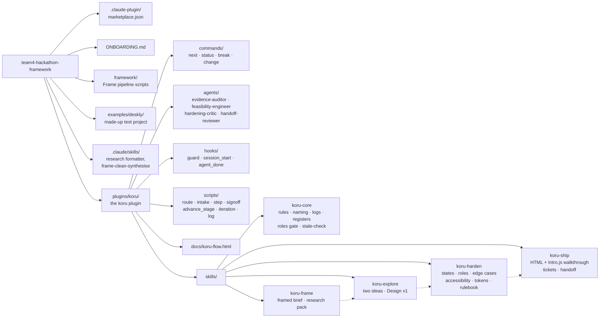

# team4-hackathon-framework

Koru 3.0 Design Ops hackathon: an AI-DLC-style delivery framework (Frame → Explore → Harden → Ship),
built as Claude Code skills plus small deterministic scripts. People review before anything becomes context.

## What's here

| Path | What it is |
|---|---|
| `.claude/skills/markdown-research-formatter/` | Skill: any research file → Claude-readable Markdown, word for word. Project-agnostic via `research-profile.json`. |
| `.claude/skills/frame-clean-synthesise/` | Skill: Frame step 1. Cleans a project's transcripts, then builds the checked `synthesis.json`. |
| `plugins/koru/` | The **koru** Claude Code plugin: the whole playbook (Frame, Explore, Harden, Ship) behind one command, `/koru:next`. See [plugins/koru/README.md](plugins/koru/README.md). |
| `.claude-plugin/marketplace.json` | Makes this repo a plugin marketplace (`team4-koru`) so teammates can install koru. |
| `ONBOARDING.md` | Teammate guide to the koru plugin: install, first engagement, who checks what. |
| `framework/` | Pipeline scripts and docs. Start with [framework/README.md](framework/README.md). |
| `examples/deskly/` | Made-up test project (no real people or clients). |

## Site map



Solid lines are folders; dotted lines are the order the stages hand on. The file-by-file tree is in [plugins/koru/README.md](plugins/koru/README.md#site-map).

## The koru plugin (the full playbook)

The plugin runs a whole engagement through **Frame → Explore → Harden → Ship**. Claude drafts; a named person checks every AI step; only signed-off files become project knowledge. Install it once in Claude Code, from this repo:

```
/plugin marketplace add ./
/plugin install koru@team4-koru
```

Restart Claude Code, then type `/koru:next`. The first time it asks the intake questions and the names of the people in each role; after that it runs the next step, stops wherever a person has to check or decide, and hands a finished stage on to the next. `/koru:status` shows where things stand without changing anything.

| Stage | Hands on | People decide |
|---|---|---|
| Frame | One-page framed brief, reviewed research pack | Senior signs the brief, research owner the pack |
| Explore | Directions, two ideas with wireframes, concept tests, Design v1 | Designer decides at 3 checkpoints; team lead signs off |
| Harden | Every state, role, edge case, AI state and accessibility check; engineer feasibility; tokens; rulebook checks | Engineer answers feasibility; design lead decides fixes vs Ship notes |
| Ship | Clickable HTML deliverable with an Intro.js walkthrough, 3 to 5 tickets (Jira CSV and markdown), handoff note | Stories agreed, walkthrough tested by a new user, engineer signs; each round to the build team is a new handoff version |

Skills hold the judgement, scripts enforce the rules the same way every time (named checker, stale-check, handoff gates), hooks block unsafe edits, and four reviewer agents give an independent read. Details in [plugins/koru/README.md](plugins/koru/README.md) and [ONBOARDING.md](ONBOARDING.md).

## Set up the Frame pipeline (once per teammate)

1. Clone the repo and open the folder in Claude Code (desktop app or `claude` in a terminal).
   Skills in `.claude/skills/` load automatically for anyone working in this folder; nothing to install.
2. Install the one Python dependency (Python 3.9+):
   ```bash
   pip3 install -r requirements.txt
   ```
3. Try it on the example: ask Claude *"run frame step 1 on examples/deskly"*, or run the script directly:
   ```bash
   python3 framework/scripts/frame_build_synthesis.py build examples/deskly/frame
   ```

## Use it on a real project

1. Make `projects/<project>/research-profile.json` (Claude will draft one with you on first run).
2. Put transcripts in `projects/<project>/frame/00-raw/` with a `manifest.json` (fields in [framework/README.md](framework/README.md)).
3. Ask Claude to run Frame step 1 on `projects/<project>`.

Client transcripts are confidential: keep real projects out of shared branches unless the team has agreed where they live.
